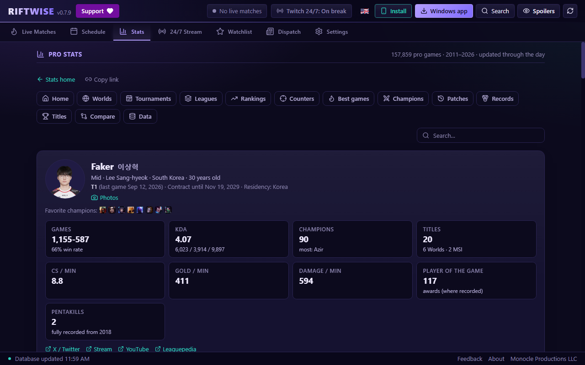
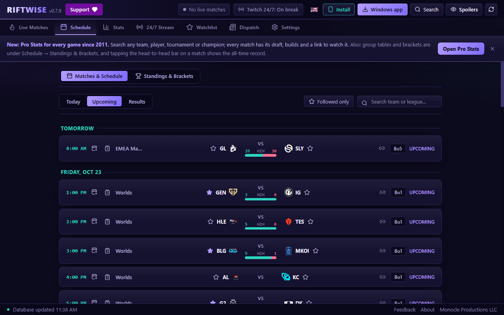
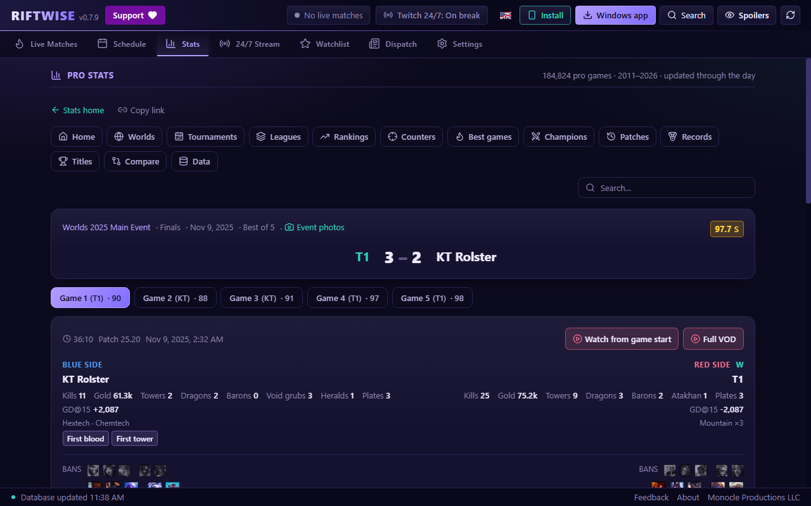
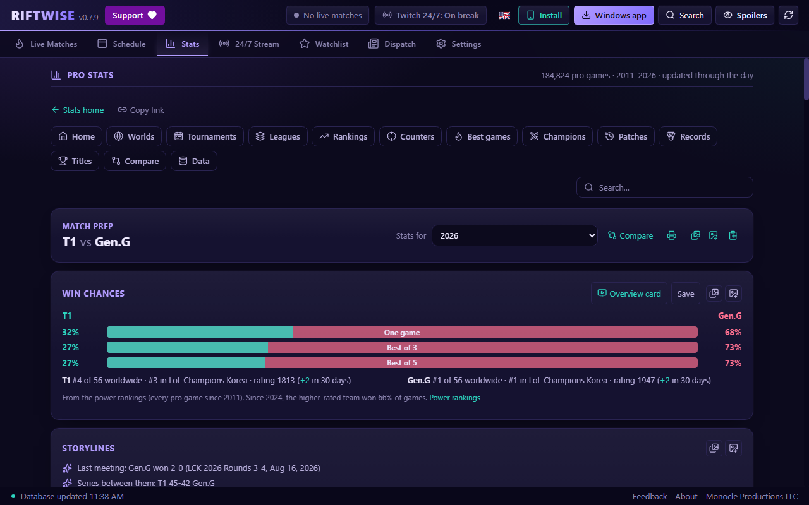
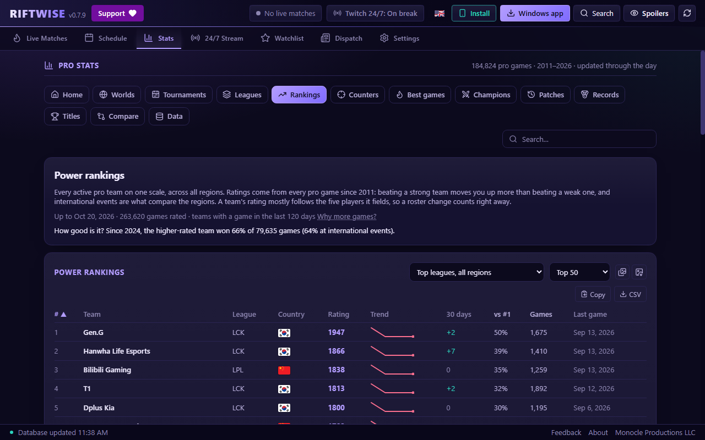
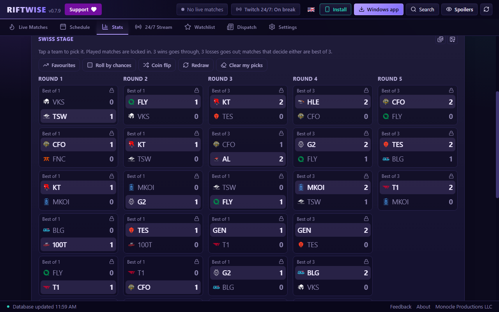

# ⚡ RiftWise

**Live League of Legends esports scores and schedules, plus pro stats for every game since 2011, in your browser or as a tiny Windows app.** Built for analysts, casters, coaches, players and fans who follow more than one league, and for viewers of the 24/7 classic-tournament Twitch stream.

> RiftWise was called **RiftWatch** up to version 0.3.40. Old links (`lolworlds.com/riftwatch`, `github.com/drmonocle/riftwatch`) forward here, and installed copies update themselves to RiftWise. Since 0.6.0 the web version lives at **riftwise.gg** (`lolworlds.com/riftwise` links forward there).

[](https://github.com/drmonocle/riftwise/releases/latest)
[](#-windows-app)
[](https://github.com/drmonocle/riftwise/actions/workflows/ci.yml)
[](LICENSE)

<p align="center">
  
</p>

## 🚀 Try it

| | |
|---|---|
| 🌐 **Web version** (any device, no install) | **[riftwise.gg](https://riftwise.gg/)** |
| 🪟 **Windows app** (tray, hotkey, notifications) | **[Download RiftWise.exe](https://github.com/drmonocle/riftwise/releases/latest/download/RiftWise.exe)** |

On a phone, open the web version and use **Add to Home Screen** to install it like an app.

---

## ✨ What it does

### 🔴 Live matches, schedule and standings
- **Live:** series score, game-by-game progress, the live game's stats (gold, kills, objectives, builds) and one-tap links to the broadcast. A match that starts **late** says so instead of pretending nothing is happening.
- **Schedule:** Today / Upcoming / Results, a "followed only" filter, search, an all-time head-to-head bar on every match and one-click **Add to Calendar**.
- **Standings & brackets:** the group tables, Swiss rounds and playoff brackets lolesports.com shows, for every league Riot lists.

<p align="center"></p>

### 📊 Pro stats for every game since 2011
- **Players, teams, tournaments, matches and champions:** careers, form, champion pools, records, drafts, builds, runes and a link to watch every game (VOD at the right moment where there is one).
- **Power rankings** for every active team on one scale across all regions, with win chances calibrated on past games.
- **Match prep** for analysts and casters: storylines, form, head-to-head, draft tendencies and every lane, for any two teams.
- **Draft board, counter-pick finder, game finder, compare** (two or more teams or players), all-time **records**, **title winners** and the **best games** ever, rated.
- **Free CSV downloads** of every game.

<p align="center"></p>
<p align="center"></p>
<p align="center"></p>

### 🌍 Worlds hub
The standout stats of the current Worlds, worked out from every game (most kills, champions that keep losing, the biggest games and series lines), each copyable as text, plus a **Swiss stage and knockout picker**: pick by hand, fill with the favourites, roll by the win chances or flip a coin, and play the rest of the tournament out 10,000 times to see every team's chances.

<p align="center"></p>

### 📺 24/7 stream, follows and alerts
- **24/7 Stream:** what the classic-tournament marathon is airing now and what is next.
- **Follow** teams, players, regions and leagues: "next match you follow", filters and alerts all use your list.
- **Alerts** on the web (phone or browser notifications) and in the Windows app.

### 🙈 Spoiler mode
Hides scores, winners, series progress, bracket results and fresh stats until you reveal them. Toggle it any time (`Ctrl+S` in the Windows app).

### 🌐 11 languages
English, Español, Português (Brasil), 한국어, Tiếng Việt, 简体中文, 繁體中文, 日本語, Français, Deutsch and Türkçe, written the way each region's fans and casters talk (롤드컵 and 원딜 in Korean, 名局 in Chinese, partidazo, jogaço...). Champion, item, rune and spell names come in the reader's language too. RiftWise picks your browser or Windows language automatically; change it under **Settings → Language**. Translator notes: [`src/i18n/GLOSSARY.md`](src/i18n/GLOSSARY.md).

### ☁️ Optional sync
Keep your follows, settings and revealed results the same on every device with a sync code or a username and password. No email or personal details needed, and everything works without it.

---

## 🪟 Windows app

Everything above, plus things a browser can't do:

- **System tray and `Alt+Shift+L`:** summon or hide RiftWise from anywhere in Windows.
- **Notifications and a hextech chime** when a match you follow goes live, 15 minutes before it starts, and when a legendary game airs on the 24/7 stream.
- **Start with Windows** (off by default), compact window mode, and **one-click updates**: the app verifies each download against its published SHA-256 before installing anything.

**Install:** download `RiftWise.exe` and run it. It is one portable file: no installer, no admin rights. It uses the Microsoft Edge WebView2 runtime that ships with Windows 10 and 11.

> **"Windows protected your PC"?** SmartScreen may warn the first time. Click **More info → Run anyway**. Every release publishes the SHA-256 of `RiftWise.exe` (`RiftWise.exe.sha256`) so you can check your download.

Keyboard (Windows app): `F5` / `Ctrl+R` refresh · `Ctrl+1…7` switch tabs (left to right) · `Ctrl+S` spoiler mode.

---

## 🔒 Privacy

No ads and no tracking cookies. Your follows and settings stay on your device (browser storage or the app's data) unless you turn on **sync**, which keeps only your username or sync code, a scrambled copy of your password and what you sync. The web version counts visits with Cloudflare Web Analytics (cookie-free, no personal data). RiftWise talks to:

| Service | Why |
|---|---|
| `esports-api.lolesports.com` | Riot's public esports data: matches, schedules, standings, rosters |
| `riftwise.gg` | The stats data, alerts and the web version itself (the old address `lolworlds.com/riftwise` if riftwise.gg can't be reached) |
| `lolworlds.com` | The 24/7 stream schedule, and accounts and sync |
| `ddragon.leagueoflegends.com`, `am-a.akamaihd.net`, `static.lolesports.com` | Riot's champion, item, team and player pictures (and Riot's image resizer) |
| `api.github.com`, `raw.githubusercontent.com`, `github.com` | Update checks, the self-refreshing head-to-head data, and release downloads |

---

## 🛠️ Build from source

Requirements: [Node.js](https://nodejs.org/) 24, [Rust](https://rustup.rs/) (stable) and the Windows C++ build tools (or the `xwin` cross toolchain, see `src-tauri/.cargo/config.toml.example`).

```powershell
npm ci
npm run tauri dev        # desktop app with hot reload
npm run dev              # browser only
npm run build:web        # the web version, built to dist-web/ (riftwise.gg)
npm test                 # frontend tests
cargo test --manifest-path src-tauri/Cargo.toml
```

**How it fits together**
- `src/` React 19 + TypeScript + Tailwind. `src/platform.ts` tells the desktop app and the web page apart. Each stats page is its own download (`src/components/hub/pageCode.ts`).
- `src-tauri/` Tauri v2 + Rust: tray, global hotkey, notifications, and the verified self-updater.
- `scripts/stats/` the stats build: `build_stats.py` + `hub.py` turn the pro games catalog (Leaguepedia, Oracle's Elixir) into the static files the stats pages read, several times a day; `audit_data.py` checks every build.
- `scripts/h2h/refresh.py` + `.github/workflows/h2h-data.yml` rebuild the head-to-head data every 6 hours and publish it to the `h2h-data` branch, which the app downloads. **That branch is data, not code: never merge it.**
- `server/` the small Go services behind riftwise.gg: `pages` (each stats page's title and link preview, sitemaps), `push` (web alerts) and `sync` (accounts), plus the IIS configuration for the old addresses.
- `web/` the service worker, manifest, icons and IIS config for the web version; `scripts/deploy_web.ps1` publishes it.

**Releases** are built by GitHub Actions, not on a developer machine. Bump the version in `package.json`, `src-tauri/tauri.conf.json` and `src-tauri/Cargo.toml` (`npm run check:version` enforces that they match), merge, then push a tag such as `v1.2.3`:

```powershell
git tag v1.2.3 ; git push origin v1.2.3
```

The `Release` workflow tests, builds on Windows and attaches `RiftWise.exe`, its SHA-256 and a zip to a **draft** release. Publishing the draft is what makes it the latest release and offers it to the in-app updater. (`scripts/package_release.ps1` builds the same files locally.)

---

## ☕ Support

RiftWise is free and open source. If it is useful to you: **[Support on Ko-fi](https://ko-fi.com/monocle)**.

## 📊 Data sources

- **[Leaguepedia](https://lol.fandom.com/)**: every pro game since 2011 (scoreboards, drafts, rosters, results, retired players' photos), shared under CC BY-SA 3.0.
- **[Oracle's Elixir](https://oracleselixir.com/)** by Tim Sevenhuysen: early-game numbers (gold / CS / XP leads at 10, 15 and 20 minutes, first blood, first tower, turret plates, void grubs, wards), used non-commercially with credit.
- **Riot's esports data and Data Dragon**: live scores, schedules, standings, rosters and pictures.

## 📜 Disclaimer

RiftWise is an unofficial fan project by Monocle Productions LLC.

RiftWise isn't endorsed by Riot Games and doesn't reflect the views or opinions of Riot Games or anyone officially involved in producing or managing Riot Games properties. Riot Games, and all associated properties are trademarks or registered trademarks of Riot Games, Inc.
